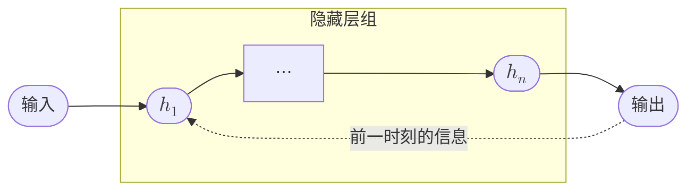
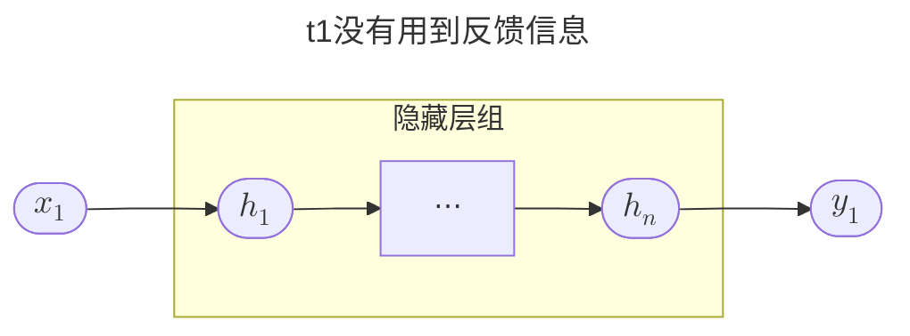
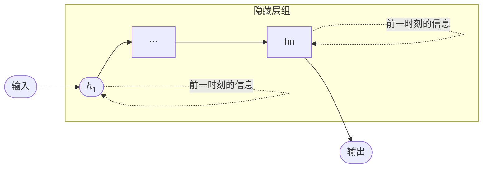

# 循环神经网络 RNN (recurrent neural network)

到前面我们重点都是关注深度学习需要的数学理论支撑——有了坚实的地基才能建设高楼。我们甚至在前面亲手造出了一台能自动求导的最小引擎，并用它训练了一个模型。但若要继续往上盖楼，靠手搓引擎逐层去造会越来越吃力，架构一旦复杂起来，就该把"造轮子"交给 PyTorch 这样的成熟框架，把注意力从底层的算子与自动求导转移到模型的架构设计上。

## MLP 的不足

前面我们见到 MLP 很擅长"输入 → 输出"式的任务：判断一个点是否在圆内、解 XOR……但有一类任务它很难优雅地搞定——**序列**。比如我们说一句话，是一个字一个字蹦出来，每个字既取决于已经说出的上文，也取决于当前要表达的意图。这类"前面的历史 + 当前输入 → 下一步输出"的任务，MLP 理论上也能做（把最近 N 个字拼成固定窗口当输入），但会遇到两个硬伤：一是序列长度不定，输入维度无法预先固定；二是窗口里每个位置各要一套权重，学不到"位置无关"的时序规律，模型会爆炸到难以训练。

因此我们需要一种**专门为序列而生**的结构：它能够接收变长的输入、在时间上复用同一组参数，并且用一个"记忆"把过去的信息携带到未来。这就是本节的循环神经网络（Recurrent Neural Network, RNN）。

从最朴素的角度考虑这个问题：当我们输入序列 $[x_1,x_2,\dots,x_T]$ 时，希望模型输出 $[y_1,y_2,\dots,y_T]$。我们把模型在时刻 $t$ 的处理过程记为 $m$，那么每个时刻的输出都可以结合当前输入与上一时刻的信息来计算：

$$
y_1=m(x_1),\quad y_2=m(x_2,y_1),\quad
y_3=m(x_3,y_2),\quad \cdots
$$

即

$$
y_t=m(x_t,y_{t-1})
$$

这里的 $y_{t-1}$ 表示上一时刻传递回来的信息。这样一来，模型就不再是孤立地处理每个输入，而是能够利用此前的信息处理当前输入，架构如下：



只使用一个比较短的模型，但是后一次的计算利用了前面几次输入的中间状态，这就是循环神经网络（RNN）的基本思想。这种把深层结果反馈回浅层的想法十分自然，但是这种架构输出层只回传把高维隐状态压成低维、且带监督语义的输出，构成信息瓶颈。所以演化出了下面这种将隐藏层最后一层反馈回隐藏层第一层的架构：


这种模型如果我们展开一下 $t_1$ 和 $t_2$ 的状态，可以等价于这样两个模型：




可以看到处理第二个输入的时候类似于是把神经网络的深度×2（虽然路径×2，但是参数只有一组），这种架构的网络跨时刻的连接只有一条(上一时刻的最后一层 → 当前时刻的第一层),历史信息必须穿过整个前向网络才能被复用到下一时刻。实际工程中为了优化历史信息传递，后来演化出了更纯粹的"隐藏状态循环传递"结构，每层各自直接复用其上一时刻的状态（即标准 RNN），每一层都有一条自己的跨时刻连接,历史信息可以在同层直接传递,不必绕行整个网络:



对于上面三种需要使用前一时刻信息的网络模型，都是RNN。标准RNN在 $t_3$ 时刻的等价模型如下：


需要注意的是，RNN 的连接不是残差那种"同一时刻、同位置、跨层的恒等相加"，而是"**跨时刻、上一时刻每个单元连到下一时刻每个单元**"的交叉全连接。

## RNN的训练

在RNN中，通常是先依次输入输出序列 ${x_T}$，得到输出序列 $y_T$，令
$$L=\frac{1}{T}\sum_{t=1}^T\operatorname{Loss}(y_t,\hat y_t)$$
即
$$L_t=\operatorname{Loss}(y_t,\hat y_t)$$
作为损失值，然后按照展开的拓扑图反向传播一次并更新参数。在"t3时刻展开拓扑图"中，我们可以看到 $h_1$ 在拓扑图中出现了三次，假设其参数为 $W$，反向传播中不同位置得到的梯度分别 $g_1$、$g_2$、$g_3$，学习率为 $r$，我们可以按照下面两种思路来更新：

1. 我们直接在不同位置各自对W更新一次（更新时使用的比例系数必须使用W的原始值，而不是先更新成新值，然后第二次的比例使用新值），$W_{\text{new}}=W-(r*g_1+r*g_2+r*g_3)$
2. 直接在真实架构中，按照第八章的知识点"计算图中节点被使用多次，梯度值累加"来刷新梯度，然后使用 $W_{\text{new}}=W-r*(g_1+g_2+g_3)$

两个方案更新的结果是一样的，我们在数学逻辑上是自洽的。

## 示例代码

下面我们手搓一个RNN网络，根据输入的正弦序列预测下一个输出：

```python :line-numbers {.line-numbers}
from typing import Sequence, cast

import torch
from torch import Tensor
from torch.nn import functional as F
from math import sin

import matplotlib.pyplot as plt

# torch.manual_seed(42)  # 固定随机种子以便复现


class RNN:
    def __init__(self, depth=2, width=2):
        self.depth = depth
        self.width = width

        def init_layer(shape: Sequence[int]):
            return (torch.randn(shape)).requires_grad_()

        self.out_layer = init_layer((1, width + 1))  # 输出层

        # 每个矩阵的行分别是神经元的权重+偏置
        # 第一行个隐藏层因为只有一个输入标量，所以是width+2（一个权重+一个偏置+自己的反馈）
        # 后面隐藏层每行需要前一层的所有输入权重+一个偏置+自己反馈
        self.hidden_layers: list[Tensor] = [
            init_layer((width, 2 + width)),
            *[init_layer((width, width + 1 + width)) for _ in range(depth - 1)],
        ]

    def forward(
        self, xs: list[float], ys: list[float] | None = None
    ) -> float | Tensor:
        with torch.set_grad_enabled(ys is not None):
            # 初始化各隐藏层上一次的输出
            last_output: list[Tensor] = [
                torch.zeros(self.width, 1) for _ in range(self.depth)
            ]

            # 整个窗口的梯度
            total_loss: Tensor | None = None

            # 训练时保存每一个时刻的推导结果，推理时表示最终输出
            out: Tensor | None = None

            if ys is not None:
                total_loss = torch.tensor(0.0)

            for data_idx in range(len(xs)):
                # 补1可以用于偏置，得到这样一个列向量 [[x_n][1]]，当前层的输入
                layer_input = torch.tensor([[xs[data_idx]], [1]])
                for l_idx in range(self.depth):

                    # 组装前一层输出和当前层上一次输出
                    lastOut = last_output[l_idx]
                    cat = torch.cat([lastOut, layer_input], dim=0)

                    layer = self.hidden_layers[l_idx]

                    inner_output = layer @ cat  # 矩阵计算

                    layer_output = F.tanh(inner_output)  # 激活函数

                    last_output[l_idx] = layer_output  # 缓存本次输出

                    # 在结果后面补一个标量1作为下一层输入，1用于偏置计算
                    layer_input = torch.cat([layer_output, torch.ones((1, 1))], dim=0)

                if ys is not None:
                    # 输出层使用线性激活函数（现在系数暂时为1）
                    out = (self.out_layer @ layer_input) * 1
                    loss = F.mse_loss(torch.tensor([[ys[data_idx]]]), out)
                    assert total_loss is not None
                    total_loss = total_loss + loss
                elif data_idx == len(xs) - 1:
                    # 推理的时候，暂时不需要输出中间结果
                    # 输出层使用线性激活函数（现在系数暂时为1）
                    out = (self.out_layer @ layer_input) * 1

            if ys is not None:
                assert total_loss is not None
                return total_loss
            else:
                assert out is not None
                return out.item()

    def train(self, xs: list[float], ys: list[float], learning_rate=0.05):
        total_loss = cast(Tensor, self.forward(xs, ys))

        # 平均梯度，不计算平均梯度也没事，这里相当于是影响学习率而已，可以通过学习率调整
        avg_loss = total_loss / len(xs)

        avg_loss.backward()  # 反向传播

        with torch.no_grad():  # 关闭求导系统（别让计算图继续记录梯度的推导了）
            # 开始刷新参数
            assert self.out_layer.grad is not None
            self.out_layer -= learning_rate * self.out_layer.grad
            self.out_layer.grad = None  # 清空梯度，避免下轮训练被累加
            for layer in self.hidden_layers:
                assert layer.grad is not None
                layer -= learning_rate * layer.grad
                layer.grad = None  # 清空梯度，避免下轮训练被累加
        return total_loss


data_length = 3000  # 数据大小
window = 10  # 训练和推理窗口

# 生成训练数据
t = [x * 0.5 for x in range(data_length)]
train_data: list[float] = [sin(x * 0.5) for x in t]

rnn = RNN()

loss_list = []
for step in range(data_length - (window + 1)):
    w_s = step
    loss = rnn.train(
        train_data[w_s : w_s + window],
        train_data[w_s + 1 : w_s + window + 1],
        learning_rate=0.01,
    )
    loss_list.append(loss.item())

result = []
for step in range(data_length - (window + 1)):
    real = train_data[step + window]
    prediction = rnn.forward(train_data[step : step + window])
    result.append({"real": real, "prediction": prediction})

plt.figure()
plt.plot([x * 0.5 for x in range(len(loss_list))], loss_list, label="损失值")
plt.title("Loss示例")  # 标题
plt.xlabel("X 轴 (时间)")  # X轴标签
plt.ylabel("Y 轴 (损失)")  # Y轴标签
plt.legend()  # 显示图例
plt.grid(True)  # 显示网格线

plt.figure()
plt.plot(
    [x * 0.5 for x in range(200)],
    [item["real"] for item in result[:200]],
    label="真实曲线",
)
plt.plot(
    [x * 0.5 for x in range(200)][:200],
    [item["prediction"] for item in result[:200]],
    label="预测曲线",
)
plt.title("预测曲线")  # 标题
plt.xlabel("X 轴 (时间)")  # X轴标签
plt.ylabel("Y 轴")  # Y轴标签
plt.legend()  # 显示图例
plt.grid(True)  # 显示网格线


plt.show()

```

我们使用一个滑动窗口来训练模型，运行上面的代码我们可以看到训练结果（因为是使用随机数初始化模型参数，可能出现无法收敛的情况，可以多运行几次）。不难看出，就算是 2 × 2的网络，对于正弦波这种比较简单的序列也有很好的识别结果。
