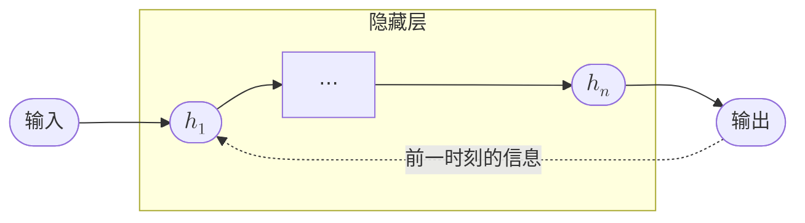
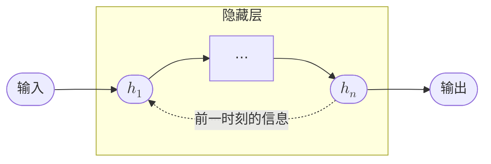
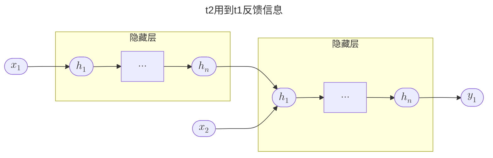
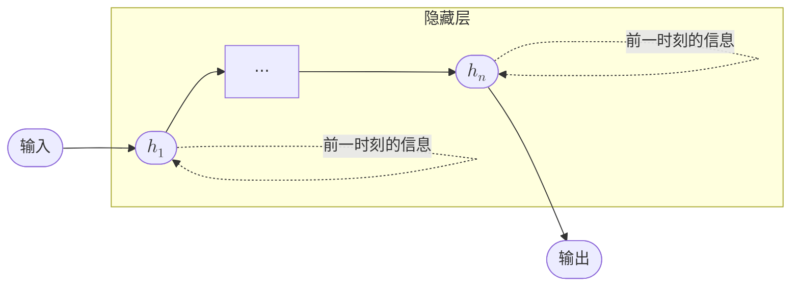

# 循环神经网络 RNN (recurrent neural network)

到前面我们重点都是关注深度学习需要的数学理论支撑——有了坚实的地基才能建设高楼。我们甚至在前面亲手造出了一台能自动求导的最小引擎，并用它训练了一个模型。但若要继续往上盖楼，靠手搓引擎逐层去造会越来越吃力，架构一旦复杂起来，就该把"造轮子"交给 PyTorch 这样的成熟框架，把注意力从底层的算子与自动求导转移到模型的架构设计上。

## MLP 的不足

前面我们见到 MLP 很擅长"输入 → 输出"式的任务：判断一个点是否在圆内、解 XOR……但有一类任务它很难优雅地搞定——**序列**。比如我们说一句话，是一个字一个字蹦出来，每个字既取决于已经说出的上文，也取决于当前要表达的意图。这类"前面的历史 + 当前输入 → 下一步输出"的任务，MLP 理论上也能做（把最近 N 个字拼成固定窗口当输入），但会遇到两个硬伤：一是序列长度不定，输入维度无法预先固定；二是窗口里每个位置各要一套权重，学不到"位置无关"的时序规律，模型会爆炸到难以训练。

因此我们需要一种**专门为序列而生**的结构：它能够接收变长的输入、在时间上复用同一组参数，并且用一个"记忆"把过去的信息携带到未来。这就是本节的循环神经网络（Recurrent Neural Network, RNN）。

从最朴素的角度考虑这个问题：当我们输入序列 $[x_1,x_2,\cdots,x_n]$ 时，希望模型输出 $[y_1,y_2,\cdots,y_n]$。我们把模型在时刻 $t$ 的处理过程记为 $m$，那么每个时刻的输出都可以结合当前输入与上一时刻的信息来计算：

$$
y_1=m(x_1),\quad y_2=m(x_2,y_1),\quad
y_3=m(x_3,y_2),\quad \cdots
$$

即

$$
y_t=m(x_t,y_{t-1})
$$

这里的 $y_{t-1}$ 表示上一时刻传递回来的信息。这样一来，模型就不再是孤立地处理每个输入，而是能够利用此前的信息处理当前输入。不过，如果直接把最终输出 $y_{t-1}$ 反馈回网络，输出层可能会丢失网络内部丰富的特征信息。因此，我们可以考虑让隐藏层保留并传递内部状态，而不是只传递最终输出。

进一步地，我们引入隐藏状态 $h_t$，让上一时刻的隐藏状态 $h_{t-1}$ 与当前输入 $x_t$ 一起参与计算：

$$
h_t=f(x_t,h_{t-1})
$$

$$
y_t=g(h_t)
$$

其中，$f$ 是隐藏状态的更新函数，$g$ 是输出函数。这样，上一时刻的隐藏状态就会传递到当前时刻，使网络能够逐步积累序列中的历史信息。每个时刻使用相同的函数和参数，这就是标准循环神经网络（RNN）的基本思想。

这样构造的网络就是一个RNN。这种把深层结果反馈回浅层的想法十分自然，但是这种架构的模型梯度传递路径过长，并且输出层往往都只输出一个数字，会把网络中复杂的状态抹除。所以演化出了下面这种将隐藏层最后一层反馈回隐藏层第一层的架构：

但是这种模型如果我们展开一下 $t_1$ 和 $t_2$ 的状态，可以等价于这样两个模型：

可以看到处理第二个输入的时候相当于是把神经网络的 $\text{深度} \times 2$，在反向传播的时候同一层 $h_1$ 距离太远，而且信息是呈一条直线传播的，对历史信息的利用也会有瓶颈。实际工程中为了优化历史信息传递，后来演化出了更纯粹的"隐藏状态循环传递"结构（即标准 RNN）:

对于上面三种需要使用前一时刻信息的网络模型，都属于RNN。
`todo`：先介绍这种架构的RNN，然后说one-hot编码，然后给一个demo，再介绍和MLP深度太深遇到类似的梯度消失问题
