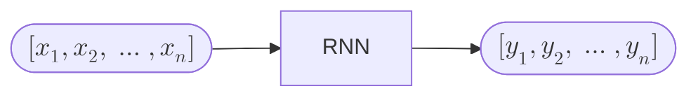

# OneHot编码

通过第九章的学习，我们实现了根据输入序列预测下一个正弦值的模型，这时候我们可能想要更进一步，什么时候能根据输入的文本预测下一个字符呢，如果能做到这点，我们就能让模型自己生成一些单词或者句子了。如果我们取26个小写字母和空格的ascii码（或者把其编码成任意不相同的数字，比如 1~27）作为模型的输入序列进行训练，理论上是可以训练出一个能预测单词或者句子的模型，架构如下：

虽然理论上这种模型是有可能训练成功的，但是难度非常大，因为输入接入隐藏层的时候，假设当前输入是字符'a'，在使用梯度下降更新和输入连接的神经元时，这个参数会同时影响字符 'b' 的输出。而从直觉上理解，在文本预测的时候，字符'a'、'b'应该是独立的，即网络应该对不同字符有独立的处理参数，避免更新某个参数的时候影响另外的输入。如果我们把标量当成一维向量，那么整个实数轴上面的非零标量都是平行的，这会让我们训练过程变得困难。于是有一种叫做“one-hot”的编码技术被发明出来，我们把 'a'、'b'、...、'z'、空格依次编码成正交的27维向量（输入有多少种可能就编码成多少维），即：

$$
\begin{aligned}
    a &=[1,0,0,\dots,0] \\
    b &=[0,1,0,\dots,0] \\
    & \cdots \\
    \text{空格} &=[0,0,0,\dots,1]
\end{aligned}
$$

这样就可以让输入连接的隐藏层使用不同的权重处理不同字符，优化模型的训练速度。需要注意的是，理论上如果第一层隐藏层放27个神经元，然后每个神经元只被一个特定输入数字激活，得到的效果和one-hot编码是一样的，但是这样的训练难度太高了，不如我们直接编码，和